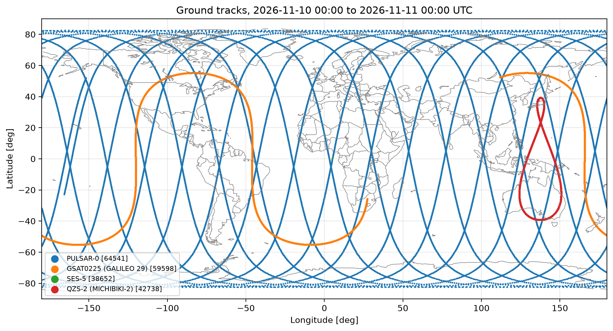
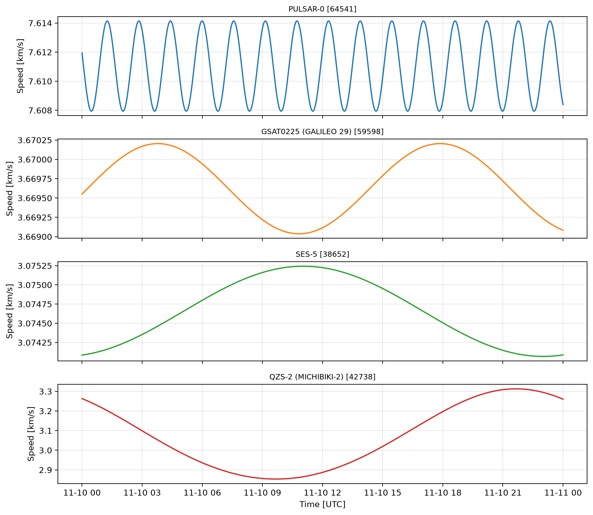

# 🛰️ Satellite Orbit Explorer

**Propagating LEO, MEO, GEO and IGSO satellites from CelesTrak GP data with a two-body Kepler model, in Python.**
*Built during Space Career Week 2026 (GNSS Academy) · Challenge 3 "Experience & Proof".*



## Overview
This notebook reads CelesTrak GP orbital elements (OMM JSON), propagates four satellites over 24 hours
(10 Nov 2026 00:00 UTC, 5 s steps, 17 281 epochs each), compares their orbits and exports the results to Google Earth.

| Satellite | NORAD | Regime | Why it is interesting |
|---|---|---|---|
| PULSAR-0 | 64541 | LEO | Sun-synchronous, ~95 min period |
| GSAT0225 (Galileo 29) | 59598 | MEO | European GNSS, ~14 h period |
| SES-5 | 38652 | GEO | Geostationary at ~5° E |
| QZS-2 (Michibiki-2) | 42738 | IGSO | Geosynchronous but inclined and eccentric |

## Method
1. **Load and validate** the GP records (OMM field names, ISO-8601 epochs).
2. **Convert to Keplerian elements:** mean motion `n` [rev/day → rad/s], semi-major axis `a = (μ / n²)^(1/3)`, angles in radians.
3. **Common time grid:** one UTC window for all satellites; records older than 7 days are flagged.
4. **Propagate:** mean anomaly → Kepler's equation (Newton–Raphson) → radius and true anomaly → inertial position →
   rotation by Greenwich Mean Sidereal Time (IAU-1982) → spherical latitude, longitude and altitude → vis-viva speed.
5. **Summarise** period, perigee, apogee, eccentricity, inclination and speed range.
6. **Visualise** ground tracks over a coastline map and speed vs time.
7. **Export** a 3D Earth-fixed KML, an animated KML for the Google Earth time slider, and a text report.

Built-in sanity checks: GMST at J2000 ≈ 280.46°, Kepler residual < 1e-10, SES-5 stays between 4° and 6° E,
Galileo period between 14.0 and 14.2 h.

## Results

| Satellite | Period | Orbit shape | Ground track |
|---|---|---|---|
| PULSAR-0 | ≈ 1.58 h | near-circular, i ≈ 97.5° (retrograde) | pole-to-pole passes drifting west |
| Galileo 29 | ≈ 14.08 h | circular, i ≈ 56° | wide sine wave up to ±56° |
| SES-5 | ≈ 23.93 h (1 sidereal day) | circular, equatorial | a single point near 5° E |
| QZS-2 | ≈ 23.93 h | e ≈ 0.07, i ≈ 39° | asymmetric figure-8 over Asia–Oceania |



### Comparing orbital regimes
<!-- ✍️ Antonio: reescribe esto con tus palabras y tus números (closing challenge del curso) -->
**GEO vs IGSO.** SES-5 and QZS-2 have the same period, one sidereal day, so both repeat the same ground track every day.
The difference is geometry: SES-5 is equatorial and circular, so it keeps pace with the Earth and appears as a fixed point.
QZS-2 is inclined 39° and slightly eccentric, so it swings north and south and draws a figure-8. The loop is asymmetric
because the satellite moves slowest at apogee, which is placed over the northern hemisphere. That is exactly what
Japan's QZSS wants: long dwell time at high elevation over Japan.

**LEO vs MEO.** PULSAR-0 completes about 15 orbits a day. The Earth rotates ~24° under it during each orbit, so its
passes shift west and, with a ~97.5° inclination, reach almost every latitude, which is ideal for Earth observation.
Galileo, at ~23 200 km altitude, needs ~14 h per orbit and covers the globe more slowly with wider swaths: a few
satellites in view from anywhere on Earth, which is what a GNSS constellation needs.

**Speed.** Circular orbits keep an almost constant speed (≈ 7.5 km/s in LEO, ≈ 3.6 km/s in MEO, ≈ 3.07 km/s in GEO).
QZS-2's speed changes along the orbit, faster at perigee and slower at apogee, as the vis-viva equation predicts.

## Assumptions & limitations
- **Two-body model:** no J2 (nodal and perigee drift), no atmospheric drag (relevant for LEO), no Sun/Moon or solar radiation pressure.
- **Mean elements:** GP data are SGP4 mean elements in the TEME frame; using them as osculating Keplerian elements is an approximation.
- **Earth model:** spherical Earth (R = 6378.137 km), so latitudes are geocentric, not WGS-84 geodetic.
- **Earth rotation:** GMST only; no precession, nutation or polar motion.
- **Epoch age:** the QZS-2 record is ~24 days older than the window, so its predicted position is the least reliable.

This is an educational model, not a precision orbit predictor. A natural next step is to compare it against SGP4
(`python-sgp4`) and quantify the error.

## How to run
**Google Colab (as delivered for the course):**
1. Open `Satellite_Orbit_Explorer.ipynb` in Colab and choose *Runtime → Run all*.
2. When Stage 2 asks, drag `orbit_workshop_inputs.zip` (not unzipped) into `/content`.

**Locally (VS Code + Jupyter):**
```bash
pip install -r requirements.txt
```
Put `orbit_workshop_inputs.zip` in the project folder, open the notebook and run all cells. Outputs are written to
`satellite_orbits/output/`.

Open the `.kml` files in **Google Earth Pro** (*File → Open*); the animation plays with the time slider.

## Repository structure
```
satellite-orbit-explorer/
├── Satellite_Orbit_Explorer.ipynb   # the notebook (8 stages)
├── requirements.txt
├── outputs/                         # plots, KML and report from a full run
└── README.md
```

## What I learned
- How GP/OMM mean elements map to classical Keplerian elements, and why their epoch age matters.
- Solving Kepler's equation numerically and moving from an inertial frame to an Earth-fixed frame.
- Reading ground tracks: why GEO is a point, IGSO a figure-8 and LEO a set of westward-shifting passes.
- Writing KML / gx:Track files to visualise orbits in Google Earth.

## Next steps
- **Galileo visibility and DOP from Madrid:** elevation mask, satellites in view and PDOP over 24 h.
- Validate against SGP4 and add J2 secular effects.

## Credits
Workshop by **GNSS Academy**, Space Career Week 2026 (#SCW26). Orbital data from [CelesTrak](https://celestrak.org).

**Author:** Antonio Rodríguez-Palmero Tajuelo, Telecommunications Engineering student at ETSIT-UPM · [LinkedIn](TU-LINKEDIN)
